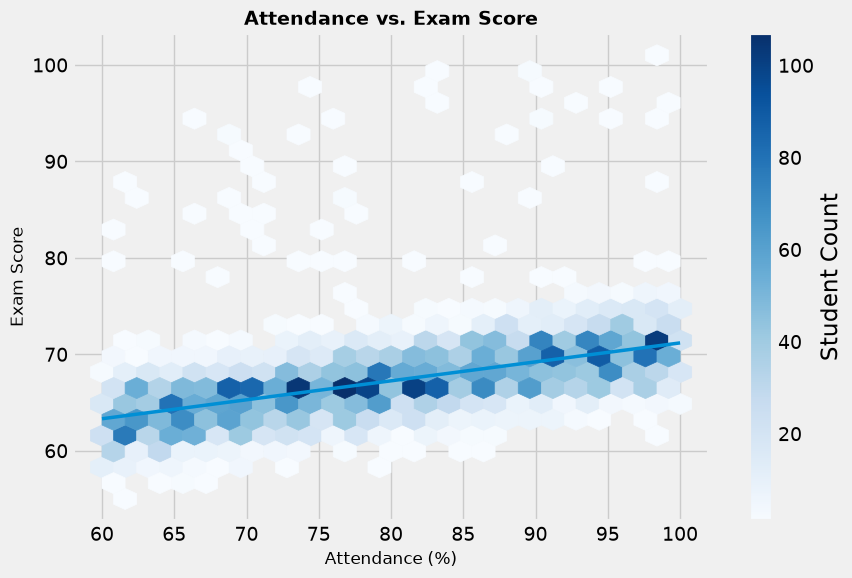
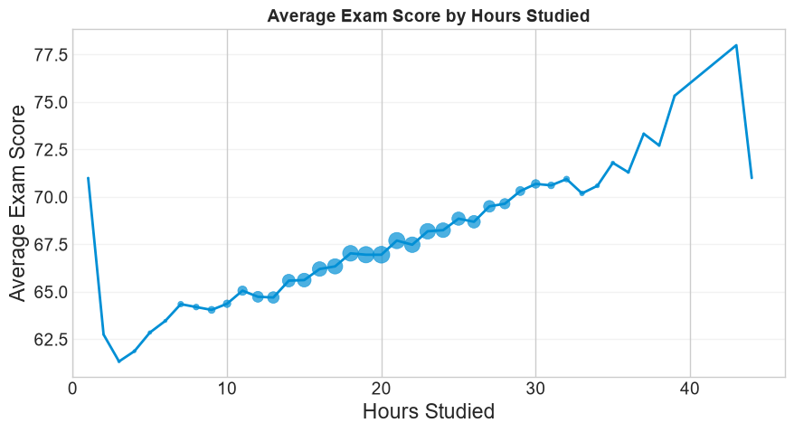
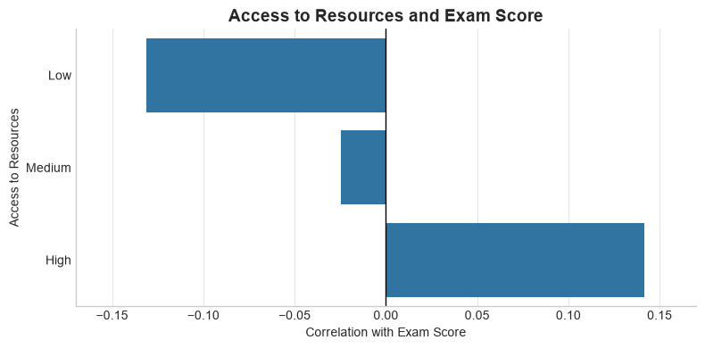

::: {.report-details}
**Prepared for** Stakeholders

**Prepared by** Sebastian Saverino

**Organization / Course** Fake Organization

**Date** 10/12/2026

**Technical repository** <https://github.com/Sebastian-Saverino/school-analytics-report-practice.git>
:::

# 1 Performance Snapshot

| Average exam score | Student count | Average attendance (%) |
|:---|:---|:---|
| **67.25** | **6,378 students** | **80** |

: Table 1. Student performance snapshot

## Snapshot Interpretation

The average exam score is 67.25, which this report considers
unsatisfactory. The 6,378 students have an average attendance rate of
80%. The analysis identifies a strong correlation between attendance and
exam scores, making attendance a priority for more effective monitoring
and enforcement.

# 2 Introduction

This report examines exam-related data to inform decisions about student
performance. Building on the performance snapshot, it identifies
opportunities to improve attendance within the school.

# 3 Primary Focus

Attendance is the primary focus because it is a factor the school can
work to improve through enforcement.

# 4 Findings and Visual Evidence

## 4.1 Attendance

{fig-alt="Attendance and exam scores"}

Of the factors examined, attendance has the strongest correlation with exam scores. Higher attendance is associated with higher exam scores, which the report interprets as an indication of higher-quality education. The report also raises the possibility that the exams are too difficult; the chart nevertheless shows that higher attendance is associated with higher grades.

## 4.2 Hours Studied

{fig-alt="Average exam score by hours studied"}

The analysis shows a strong correlation between hours studied and exam scores, underscoring the importance of time spent studying.

## 4.3 Access to Resources

{fig-alt="Access to resources and correlation with exam scores"}

The chart shows substantial differences in the correlation with exam scores across high, medium, and low levels of resource access. The report interprets this pattern as indicating that grades decline substantially as access to resources decreases.

# 5 Improvement Opportunities

## 5.1 Attendance

The analysis identifies attendance as a problem associated with exam
scores. Attendance Works states that students who missed 2 to 4 days in
September were 5 times more likely to be chronically absent during the
year than those who missed fewer than 2 days \[1\]. This highlights the
risk that attendance problems can compound alongside declining grades.
The California Department of Education emphasizes the importance of
ensuring that everyone in the school system understands the positive and
negative effects of attendance \[2\]. The proposed actions are to focus
more closely on barriers to attendance and to explain in each class both
the expectation to attend and why attendance matters.

## 5.2 Hours Studied

The analysis identifies hours studied as an important factor associated
with exam scores, with marginal increases in scores as study hours rise.
However, study quality and study quantity are distinct considerations.
Proposed approaches include a dedicated study hall and greater awareness
of effective study habits. The UNC Learning Center offers guidance on
improving both the amount of time spent studying and how that time is
used \[3\]. The report also notes cases in which students studied
extensively but received low scores, suggesting poor study habits or a
lack of honesty on the test as possible explanations.

## 5.3 Access to Resources

The chart shows the correlation between access to resources and exam
scores. The Stanford Report discusses the disadvantages that a lack of
resources can create \[4\]. Drawing on its guidance, the proposed
approach is to ask students to identify the best resources available to
them, whether through the school or elsewhere. This information could
help the school allocate resources more efficiently to students who need
them.

# 6 Closing Remarks

School faculty have limits on what they can accomplish, but sharing
these findings with both staff and students can make an impact. Students
are regularly told to attend school; explaining the reasons through data
can help them understand why attendance matters.

The next steps are to increase awareness of attendance and study habits,
provide more study time within classes, and secure additional funding to
support students with limited access to resources.

Because this analysis uses synthetic data, it cannot by itself justify
action in a real school. Data also provide only part of the picture.
Meaningful change requires an understanding of the school's existing
support and practices. The analysis can serve as a starting point;
examining specific problems in greater detail can help identify the most
appropriate course of action.

# 7 References

\[1\] Attendance Works. "10 Facts About School Attendance."
https://www.attendanceworks.org/chronic-absence/the-problem/10-facts-about-school-attendance/

*Citation incomplete: publication date and individual author details, if
applicable, were not supplied.*

\[2\] California Department of Education. "School Attendance Improvement
Strategies." https://www.cde.ca.gov/ls/ai/cw/attendstrategy.asp

*Citation incomplete: publication date and individual author details, if
applicable, were not supplied.*

\[3\] UNC Learning Center. "Studying 101: Study Smarter Not Harder."
https://learningcenter.unc.edu/tips-and-tools/studying-101-study-smarter-not-harder/

*Citation incomplete: publication date and individual author details, if
applicable, were not supplied.*

\[4\] Stanford Report. "Studying more strategically equals improved exam
scores."
https://news.stanford.edu/stories/2017/05/studying-strategically-equals-improved-exam-scores

*Citation incomplete: publication date and individual author details, if
applicable, were not supplied.*
